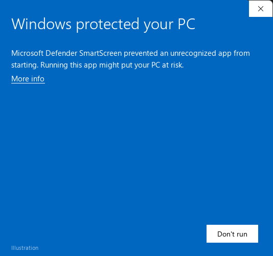
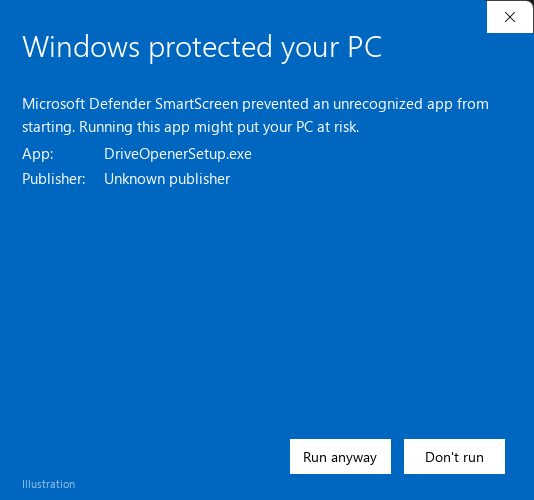

# Drive Opener (host app)

[日本語](README.md) | English

The program on your computer (the **host app**) for the Chrome extension "Drive Opener", which **opens the Google Drive folder or file you are viewing in Chrome directly in Windows File Explorer, with one click**.

- The extension will be distributed on the Chrome Web Store (coming soon; it is not included in this repository)
- This repository contains the host app, which the extension calls to open File Explorer, and its installer

## Requirements

- Windows 10 / 11 (64-bit)
- Google Chrome
- [Google Drive for desktop](https://www.google.com/drive/download/), installed and signed in
- The Chrome extension "Drive Opener"

## Download

**[Download DriveOpenerSetup.exe](../../releases/latest/download/DriveOpenerSetup.exe)** (latest version)

Older versions and SHA-256 checksums are on the [releases page](../../releases).

## Install

1. Download `DriveOpenerSetup.exe` from the link above
2. Open the downloaded file (double-click it)
3. Follow the steps on the screen (**no administrator rights needed**)
4. In Chrome, open the Drive Opener options page and click "Check again". When it says "Installed", you are done
   - If it is not detected, close all Chrome windows, open Chrome again, and click "Check again"

### If Windows shows a warning

This installer is **not code-signed** yet, so Windows or Chrome may show a warning when you download or run it.

#### Warning when downloading in Chrome

If the download list says something like "this file isn't commonly downloaded", open the menu for that download and choose **"Keep"** (or "Download suspicious file").

#### "Windows protected your PC"

1. On the blue screen, click **"More info"**

   

2. Click **"Run anyway"**

   

   These images are illustrations of the English screen. The actual screen may look slightly different depending on your version of Windows.

## Uninstall

In Windows, open **Settings → Apps → Installed apps**, select **"Drive Opener host app"** (or "Drive Opener ホスト" if it was installed in Japanese), and click "Uninstall". This removes the program files and its registration with Chrome (in the registry).

## Privacy

- This program **does not send your Google Drive data or file names anywhere**. It does not connect to the internet
- To find where a folder is on your computer, it reads the local database that Google Drive for desktop keeps on your computer (`%LOCALAPPDATA%\Google\DriveFS\…\metadata_sqlite_db`) in **read-only** mode. It never changes it
- All it does is look up the folder for the ID it receives from the extension and open it in File Explorer

For details on both the extension and the host app, see the [Privacy Policy](PRIVACY.en.md).

## How it works

```
Chrome extension (gets the ID from the Google Drive page)
  → Native Messaging → this host app (%LOCALAPPDATA%\DriveOpener\drive_opener.exe)
      looks up the local path for the ID in Google Drive for desktop's database (for example G:\My Drive\…)
      → checks that it exists and opens it with explorer.exe
```

- It accepts only three kinds of requests: `ping`, `open`, and `resolve`. It receives only an ID from the extension and builds the path itself
- The installer writes only to the current user's area (`%LOCALAPPDATA%` and `HKEY_CURRENT_USER`)

## Code signing

The installer is currently not code-signed. We are considering applying for code signing.

## For developers

### Build

Requirements: Python 3.11, `python -m pip install pyinstaller`, [Inno Setup](https://jrsoftware.org/isinfo.php) (6 or 7)

```powershell
powershell -ExecutionPolicy Bypass -File build.ps1
```

Output: `dist\drive_opener\` (the host app) and `dist\DriveOpenerSetup-<version>.exe` (the installer)

The installer is in English and Japanese and picks the language from the Windows display language. To check a specific language, run it with `/LANG=english` or `/LANG=japanese`.

### Test

```powershell
python -m unittest discover -s tests
```

### Release

1. Bump `VERSION` in `host/drive_opener.py`, write the changes in English and Japanese in `release-notes/<version>.md` (English first; see `release-notes/1.1.0.md`), and commit
2. Push a tag `host-v<version>` (for example `host-v1.2.0`)
3. GitHub Actions builds it and attaches the installer (versioned and `DriveOpenerSetup.exe`) and `SHA256SUMS.txt` to a **draft** release. The release notes are the changes plus common text (files, README links, not code-signed) in English and Japanese (`tools/make_release_notes.py`). The build stops if `release-notes/<version>.md` is missing
4. Review the draft, then publish it

To check the release notes without pushing a tag, run the "build-host" workflow manually from the Actions tab (the notes appear in the log and the run summary; no draft is created)

## License

[MIT License](LICENSE)
